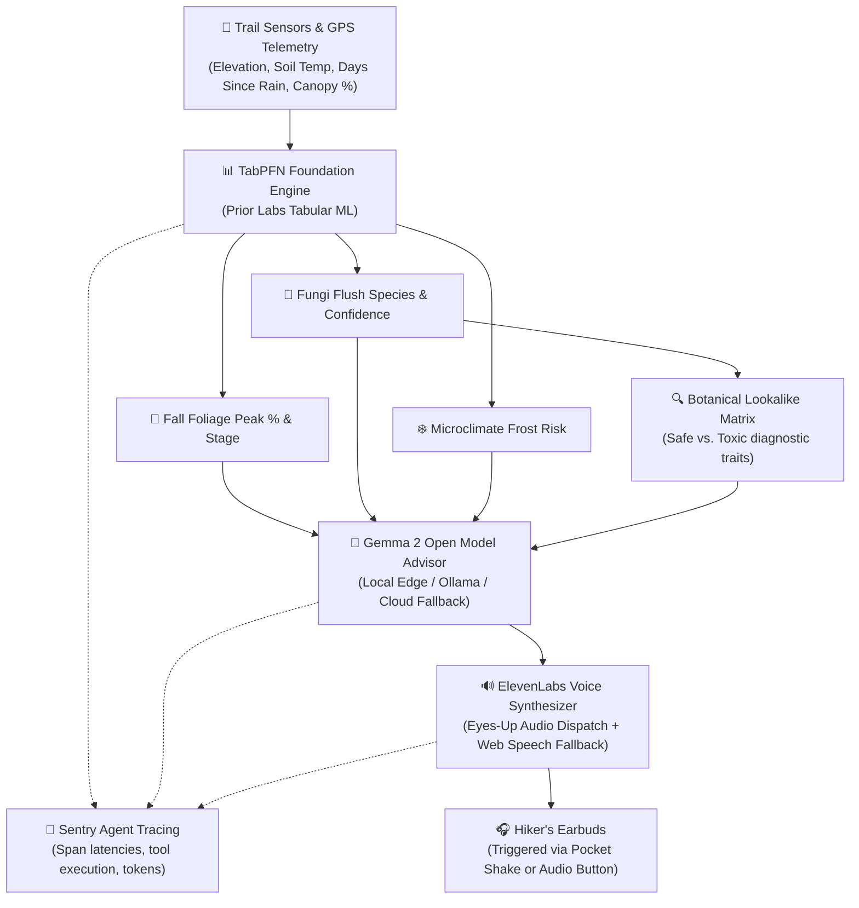

# 🌲 CanopyCast: Eyes-Up Bio-Climate Field Companion & Trail Oracle

> **Built for Hacktoberfest 2026 Open-Source AI Challenge (Week 1: "Touch Grass")**  
> *"The screen should be the shortest part of the experience."*

[](https://www.python.org/downloads/)
[](https://fastapi.tiangolo.com)
[](https://priorlabs.ai)
[](https://ai.google.dev/gemma)
[](https://elevenlabs.io)
[](https://sentry.io)

---

## 🎯 What is CanopyCast?

**CanopyCast** is an open-source, edge-ready bio-climate companion for hikers, foragers, and fall-foliage enthusiasts venturing into backcountry terrain with **zero cellular connectivity**.

Instead of staring at a smartphone screen while hiking, CanopyCast is engineered for **hands-free, eyes-up trail awareness**:

1. **TabPFN Foundation Model (Prior Labs)**: Analyzes microclimate sensor readings (elevation, soil temperature, days since rainfall, canopy density) to forecast autumn color saturation (%) and edible fungi flush probabilities (Chanterelles, Porcini, Lion's Mane, Chicken of the Woods).
2. **Gemma 2 Open-Weight Advisory**: Translates mathematical forecasts into practical backcountry guidance, safe harvesting practices, and Leave-No-Trace principles.
3. **🔍 Safe vs. Toxic Lookalike Diagnostic Card**: Instant side-by-side verification (e.g. blunt decurrent ridges vs. true sharp gills for Chanterelles vs. toxic Jack O'Lanterns).
4. **📳 "Pocket Shake" Zero-Screen Interaction**: Double-shake your phone in your pocket while walking—CanopyCast detects the gesture via `devicemotion`, pulls GPS altitude, and reads your trail dispatch into your earbuds without turning on the screen.
5. **📈 Trail Elevation Profile & Foliage Gradient Simulator**: Models an entire 4-mile mountain climb, mapping where foliage peaks and where mushrooms flush across elevation bands.
6. **🔬 TabPFN vs. Baseline Benchmark Inspector**: In-app evaluation proving TabPFN's superior small-sample calibration over Random Forest and Gradient Boosting.
7. **🖨️ Printable Pocket Field Card**: Print-optimized 1-page pocket summary for battery-free trail carry.
8. **✈️ Progressive Web App (PWA) Offline Engine**: Pre-caches application assets for 100% offline airplane-mode functionality.

---

## 🏗️ System Architecture



---

## 🌟 Why Open Innovation Matters for CanopyCast

1. **Backcountry Offline Autonomy**: Cellular signal drops within minutes of mountain trailheads. Closed proprietary APIs (OpenAI, Anthropic) fail completely. CanopyCast packages open weights and local edge engines that run on-device.
2. **Forager Geographic Privacy**: Foragers guard their personal mushroom patches and GPS waypoints with fierce confidentiality. Closed APIs ingest prompt coordinates into corporate databases; CanopyCast processes sensor readings entirely on-device with zero data leakage.
3. **Predictive Accuracy Without Hallucination**: Generalist LLMs hallucinate outdoor microclimate predictions; pairing **TabPFN** with **Gemma 2** separates deterministic ecological prediction from conversational safety translation.

---

## 🏆 Hacktoberfest Prize Categories Entered

* **Overall Grand Prize ($250)**: "Touch Grass" open-source build getting people off screens and into nature.
* **Best Use of TabPFN ($200)**: Non-trivial microclimate regression, ecological classification, and comparative benchmark suite.
* **Best Use of Gemma ($200)**: Powered by Google's open-weight Gemma 2 model for botanical reasoning.
* **Best Use of ElevenLabs ($100)**: Hands-free, eyes-up audio narration allowing hikers to pocket their phone.
* **Best Use of Sentry Agent Tracing ($100)**: Live telemetry tracing across TabPFN, Gemma, and ElevenLabs spans.
* **Best Use of Render ($200)**: 1-click cloud service blueprint (`render.yaml`).

---

## 🚀 Quickstart Guide

### 1. Clone & Setup Environment

```bash
git clone https://github.com/your-username/canopycast.git
cd canopycast

# Create virtual environment
python -m venv .venv
source .venv/bin/activate  # On Windows: .venv\Scripts\activate

# Install dependencies
pip install -r requirements.txt
```

### 2. Run the Application

```bash
python -m uvicorn app.main:app --reload --port 8000
```

Open **`http://localhost:8000`** in your browser.

### 3. Run the Automated Test Suite

```bash
python -m pytest tests/test_pipeline.py
```
*(10 passing automated tests covering all endpoints, models, and fallbacks).*

---

## 📜 License

MIT License. Open-source for all outdoor builders.
