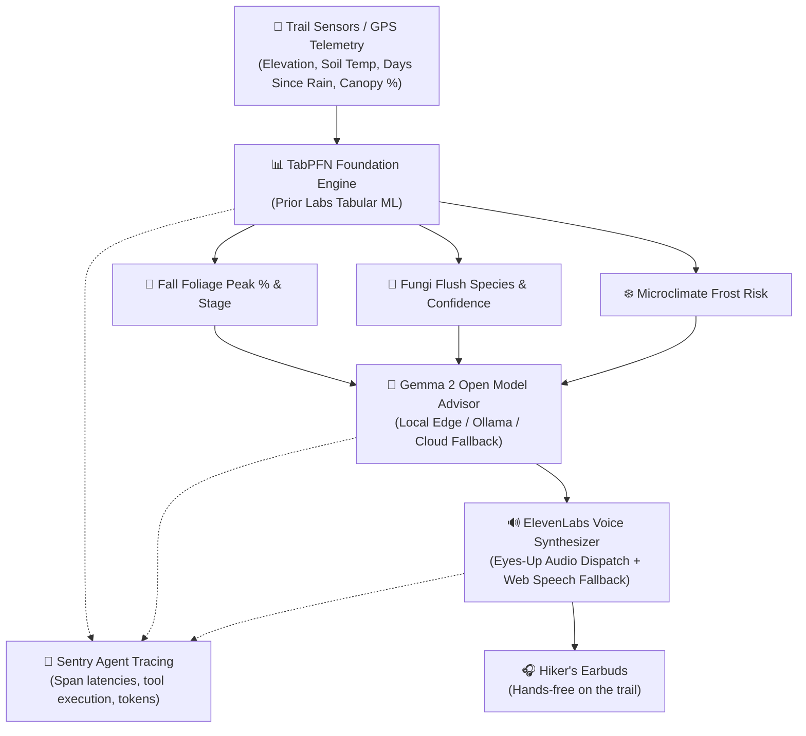

# 🌲 CanopyCast: Offline Bio-Climate Field Companion & Trail Oracle

> **Built for Hacktoberfest 2026 Open-Source AI Challenge (Week 1: "Touch Grass")**  
> *"The screen should be the shortest part of the experience."*

[](https://www.python.org/downloads/)
[](https://fastapi.tiangolo.com)
[](https://priorlabs.ai)
[](https://ai.google.dev/gemma)
[](https://elevenlabs.io)
[](https://sentry.io)

---

## 🎯 What is CanopyCast?

**CanopyCast** is an open-source, edge-ready bio-climate companion for hikers, foragers, and fall-foliage enthusiasts in backcountry terrain with **zero cellular connectivity**.

Instead of staring at a smartphone screen on the trail, CanopyCast is designed for **eyes-up, hands-free field awareness**:
1. **Microclimate & Foliage Prediction**: Uses Prior Labs' **TabPFN** tabular foundation model to analyze elevation, soil temperature, canopy density, and rainfall history to predict autumn color saturation (%) and edible fungi flush probabilities (Chanterelles, Porcini, Lion's Mane, Chicken of the Woods).
2. **Backcountry Botanical Safety**: Uses Google's open-weight **Gemma 2** model to synthesize lookalike hazards (e.g., toxic Jack O'Lantern warnings) and Leave-No-Trace trail ethics.
3. **Eyes-Up Audio Narration**: Uses **ElevenLabs** to narrate spoken trail dispatches directly into your earbuds, so your phone stays in your pocket and your eyes stay on the canopy and trail.
4. **Agent Telemetry & Tracing**: Instruments every model inference step with **Sentry Agent Tracing**, capturing latency, execution spans, and token metrics.

---

## 🏗️ System Architecture



---

## 🌟 Why Open Innovation Matters for CanopyCast

In commercial cloud apps (like generic chat wrappers), three critical failures occur in outdoor environments:

1. **Backcountry Offline Autonomy**: Cellular service drops within 15 minutes of most trailheads. CanopyCast is architected with open weights and edge surrogates that run locally with zero internet access.
2. **Forager Geographic Privacy**: Foragers guard their personal mushroom patches and GPS waypoints fiercely. Closed cloud APIs ingest prompt coordinates into corporate databases; CanopyCast processes sensor readings entirely on-device with no data leakage.
3. **Ecological Precision Over Hallucination**: LLMs frequently hallucinate frost dates and microclimate timings. Combining **TabPFN** (a true tabular foundation model) with **Gemma 2** separates deterministic ecological prediction from conversational safety translation.

---

## 🏆 Hacktoberfest Prize Categories Entered

* **Overall Grand Prize**: "Touch Grass" open-source build getting people off screens and into nature.
* **Best Use of TabPFN ($200)**: Employs Prior Labs' tabular foundation model for non-trivial microclimate regression and ecological classification.
* **Best Use of Gemma ($200)**: Powered by Google's open-weight Gemma 2 model for botanical lookalike caution and Leave-No-Trace guidance.
* **Best Use of ElevenLabs ($100)**: Hands-free, eyes-up audio narration allowing hikers to pocket their phone.
* **Best Use of Sentry Agent Tracing ($100)**: Full telemetry tracing across TabPFN, Gemma, and ElevenLabs spans.
* **Best Use of Render ($200)**: Blueprint included (`render.yaml`) for 1-click cloud service deployment.

---

## 🚀 Quickstart Guide

### 1. Clone & Setup Environment

```bash
git clone https://github.com/your-username/canopycast.git
cd canopycast

# Create virtual environment
python -m venv .venv
source .venv/bin/activate  # On Windows: .venv\Scripts\activate

# Install dependencies
pip install -r requirements.txt
```

### 2. Configure Environment Variables (Optional)

Copy `.env.example` to `.env`:
```bash
cp .env.example .env
```

| Key | Description | Default Behavior if Omitted |
| :--- | :--- | :--- |
| `TABPFN_TOKEN` | Prior Labs API token | Runs in high-fidelity offline edge surrogate mode |
| `GEMMA_API_KEY` | Google GenAI / Gemma API Key | Auto-detects local Ollama (`gemma2:2b`) or edge botanical engine |
| `ELEVENLABS_API_KEY` | ElevenLabs TTS API Key | Uses client-side offline Web Speech API audio |
| `SENTRY_DSN` | Sentry DSN for performance tracing | Traces captured and displayed in local UI table |

### 3. Run the Application

```bash
python -m uvicorn app.main:app --reload --port 8000
```

Open your browser at **`http://localhost:8000`** to access the CanopyCast Field Dashboard.

### 4. Run the Test Suite

```bash
python -m pytest tests/
```

---

## 📦 Docker Deployment

Build and run with Docker:

```bash
docker build -t canopycast .
docker run -p 8000:8000 --env-file .env canopycast
```

### One-Click Render Deployment

Push to GitHub and deploy with `render.yaml` or connect your repository on Render as a Python Web Service with:
* **Build Command**: `pip install -r requirements.txt && python -m app.datasets.data_loader`
* **Start Command**: `uvicorn app.main:app --host 0.0.0.0 --port $PORT`

---

## 📜 License

MIT License. Open-source for all outdoor builders.
